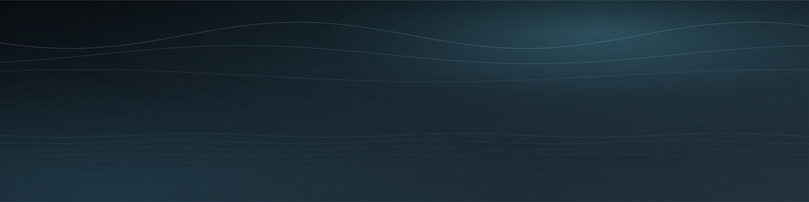

<picture>
  <source media="(prefers-color-scheme: dark)" srcset="assets/wordmark-dark.svg" />
  
</picture>

*Long-form writer · Builder*

  

He / Him · Based in Shanghai, China

I write long-form pieces and build small things. Some of them live here.
Currently studying at **JSU**.

**Chinese** (Native) · **English** (Conversational) · **Cantonese** (Conversational) · **Spanish** (Conversational)

> *“You are the light of the world.”* — Matthew 5:14 你们是世上的光。—— 马太福音 5:14

